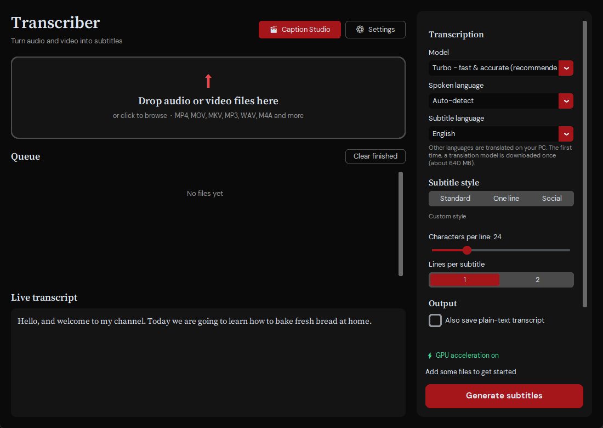

# Transcriber

**Turn any audio or video into subtitles, in any language. Free, and it all runs on your PC.**

Windows 10 &amp; 11 (64-bit) · <a href="https://github.com/irlydo/transcriber/releases/latest">All downloads</a>

  

## What it does

- **Subtitles from any video or audio:** drop files in, get `.srt` subtitles for YouTube, video editors or VLC.
- **Translate into 35 languages:** for example English video → Spanish subtitles.
- **Caption Studio:** burn animated captions straight into TikTok, Reels and Shorts videos.
- **Private:** nothing is uploaded; it runs on your PC, fastest with an NVIDIA graphics card.
- **Updates itself:** when a new version is out, the app offers **⟳ Restart to update**.

## Getting started

1. Click **Download for Windows** above and run `Transcriber-Setup.exe`.
   If Windows says *"Windows protected your PC"*, click **More info → Run anyway**.
2. Drag a video or audio file onto the window.
3. Pick a **Subtitle language** (or leave *Same as spoken*) and press **Generate subtitles**.

The `.srt` is saved next to your video. The first time, the speech model is downloaded once (about 1.6 GB).

---

Built on Whisper ([faster-whisper](https://github.com/SYSTRAN/faster-whisper)) and Meta's NLLB-200 for
translation. Building from source: [docs/BUILDING.md](docs/BUILDING.md) ·
Third-party licenses: [THIRD_PARTY_NOTICES.md](THIRD_PARTY_NOTICES.md)
